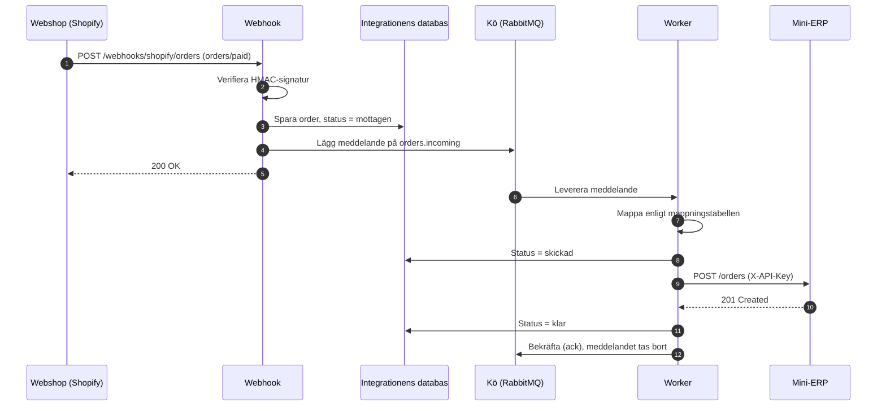
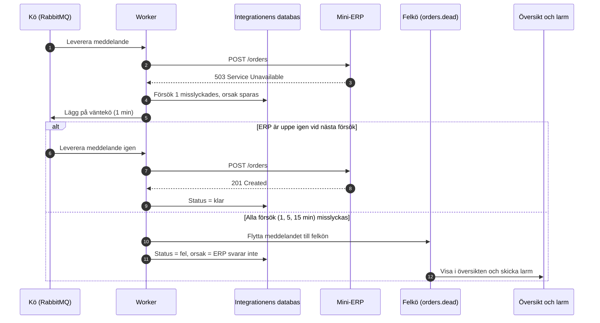
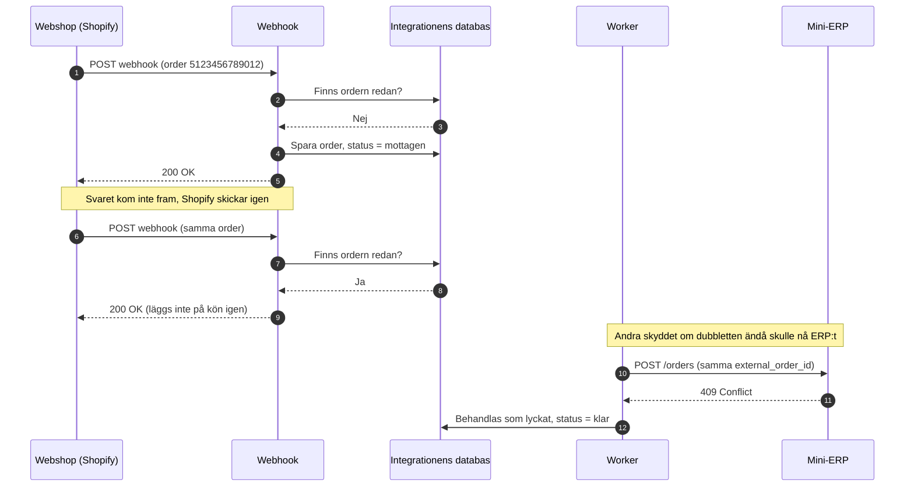
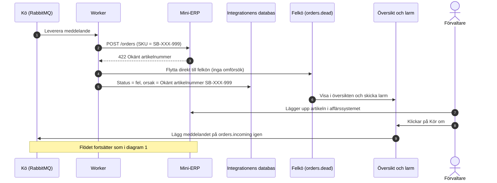
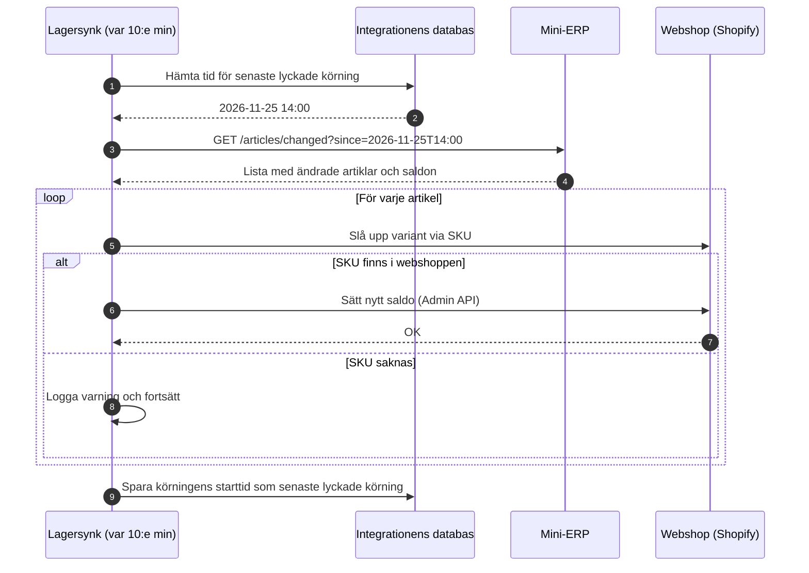

# Sekvensdiagram – Orderflödet

| | |
|---|---|
| **Version** | 0.1 (utkast) |
| **Datum** | 2026-11-25 |
| **Författare** | Sam Airey |
| **Relaterat** | [Integrationsspecifikation](integrationsspecifikation.md), [Mappningstabell](mappning.md) |

Diagrammen visar i vilken ordning systemen anropar varandra. Läs uppifrån och ned. Heldragna pilar är anrop och streckade pilar är svar.

## 1. Lyckat fall

En betald order förs över till affärssystemet (FK1).

## 2. Affärssystemet är tillfälligt nere

Ordern försöks igen med växande väntetid och försvinner inte (IFK1).

## 3. Samma webhook skickas två gånger

Ordern skapas bara en gång (IFK2).

## 4. Order med okänt artikelnummer

Ett permanent fel försöks inte igen (FK5).

## 5. Lagersynk

Schemalagd deltasynk från affärssystemet till webshoppen (FK2, FK8).

